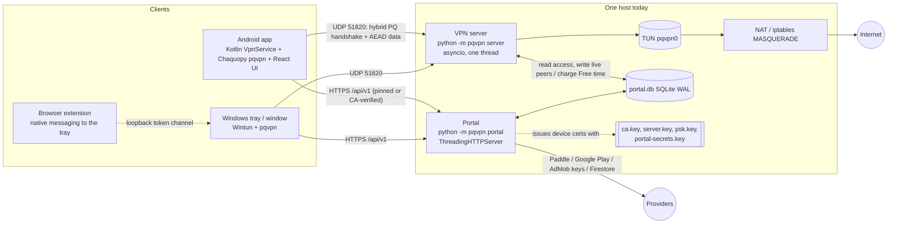

# ShieldsVPN production-readiness audit (2026-11-05)

Scope: the whole repository on branch `production-hardening` (from `shieldsvpn-android-security-upgrade` at
`82ffac0`), the WSL test deployment's file permissions (read only, nothing restarted) and the published privacy
policy. Goal: a public freemium VPN on one small VPS first, designed to grow to several gateways and 1,000+
simultaneous users. This is an engineering audit by the development assistant, **not an independent security audit**
(PRD S8 still applies before taking payments at scale).

Secret values were never printed: key files were checked by PEM label only, and the history scan reports paths and
types.

## 1. Method

| Step | How |
| --- | --- |
| Code | Every source file read: engine (`pqvpn/`), portal (`pqvpn/portal/`), desktop clients, Android (Kotlin, React UI, Gradle), browser extension, tools, deploy files, tests (test names and fixtures). |
| Documents | PRD, SPEC, PROTOCOL, SECURITY, CREDENTIALS, ENGINEERING_NOTES, privacy policy. |
| Secrets | `tools/secret_scan.py` on the working tree (0 findings) and the same classifier over **every blob of every ref** (632 objects). |
| Dependencies | `npm audit` for the mailer (production deps) and the Android UI (all deps): 0 vulnerabilities. Python: standard library only. Gradle dependencies: not audited (no offline tool here). |
| Deployment | WSL `/var/lib/pqvpn`: modes and owners, the CA key's PEM label, selected config keys. |
| Hosting | Hetzner's Cloud agreement and system-policy pages; current CX23 pricing reports. |

## 2. What the system is

Entry points: `python -m pqvpn` → `pqvpn/cli.py` (`server`, `client`, `portal`, `portal-init`, `tray`, `app`,
`browser-host`, `native-host`, PKI commands, `selftest`). Android: `MainActivity` → `ShieldsVpnService` →
`pqvpn.android_client.Session`. Runtime: Python ≥ 3.11 standard library + OpenSSL ≥ 3.5 through `ctypes`; Node.js
only for e-mail (Nodemailer).

### 2.1 Connection lifecycle (traced through the code)

1. **Registration** (app builds with a portal): the app makes an ML-DSA-65 key, `POST /api/v1/enroll` sends the
   public key; the portal allocates a tunnel address, signs a client certificate with the **root CA key** (subject
   `d-…`, address /32, 90 days), returns it with a bearer token (stored hashed). Free time 0.
2. **Free time**: rewarded ad → AdMob server-side-verification callback (ECDSA-checked) → `free_seconds` += N.
3. **Handshake** (`handshake.py`): INIT (offered suites, ML-KEM ek + X25519) → [COOKIE/RETRY] → RESPONSE (ct + X25519)
   → AUTH_I (encrypted: client cert, ML-DSA signature over the transcript, Finished) → server checks Finished, the
   chain, role, validity, revocation, then **`PortalAccess.authorize`** (device enabled, serial current, account
   enabled, Free balance > 0) → AUTH_R (server cert, signature, pushed config, Finished) → traffic keys; the client's
   first keepalive confirms the keys.
4. **Data** (`node.py`, `session.py`): 16-byte header + AEAD (counter nonce), 2048-packet replay window after
   authentication, cryptokey routing (inner source must be the certificate's address), padding to 16 bytes.
5. **Every 2 s** the server's `PortalAccess.sync` publishes live peers to SQLite, charges connected Free devices up to
   their last packet, and drops peers that are no longer allowed.
6. **Rekey** every 120 s by the client (fresh ML-KEM + X25519), keypairs expire after 180 s.
7. **Disconnect**: the client stops; the server's session lingers until expiry but charges nothing after the last
   packet.

## 3. Findings

Severity: **Critical** blocks a public launch; **High** must be fixed before real users; **Medium** before scale;
**Low** hygiene. Status as of this branch.

### Critical

| ID | Finding | Status |
| --- | --- | --- |
| C1 | **The root CA private key is online, unencrypted, inside the internet-facing portal**, and the same CA signs the server certificate. Confirmed on the WSL deployment (`ca.key` PEM label `PRIVATE KEY`, no passphrase file). A portal compromise (any RCE in the HTTP stack, a stolen backup of the data directory) lets an attacker mint a certificate for `server_name` and impersonate the VPN server to **every** client: the handshake's guarantees then reduce to "talking to whoever holds a CA-signed cert". | **Open, needs your decision** (credential rotation + client update). Plan in §5.1. |
| C2 | **Tunnel-address pool exhaustion.** The pool is one /24 (253 addresses); every registration permanently takes one (it is inside the CA-signed certificate) until the device is unused for 30 days. With 20 registrations per network per day, ~13 IPv4 addresses (or, before Phase 1, a single IPv6 /64) fill the pool in a day, and nobody new can join for up to 30 days. | **Partly mitigated** in Phase 1 (per-/64 counting, hourly cap). Real fix in Phase 3: larger pool, reclaiming never-used registrations, capacity alarms; needs H7 first. |
| C3 | **No production hosting.** The live servers are a laptop VM behind a free playit.gg UDP tunnel and WSL on the development PC; the portal uses self-signed TLS and is not publicly reachable. | Phase 8. |
| C4 | **Hosting policy not confirmed.** Hetzner's Cloud agreement does not mention VPNs, proxies or Tor, but forbids "the scanning of foreign networks" and "the use of fake source IPs"; on a public exit node, users' actions (port scans, P2P copyright notices, abuse) arrive at the operator. The owner's own location decision of 2026-10-31 was **not Germany** (Amsterdam first) because of German court rulings on adult-site blocking. | **Needs your decision** and a written answer from the provider before deployment. |

### High

| ID | Finding | Status |
| --- | --- | --- |
| H1 | The server logged every client's public IP:port at INFO **on every handshake** (each rekey, ~2 min) and a per-peer line each minute, into a log the WSL launcher appends to forever. The privacy policy says live connection data is "overwritten every few seconds; removed when you disconnect". At 1,000 peers that is also ~700,000 lines a day. | **Fixed** (Phase 1). |
| H2 | Abuse limits counted IPv6 per address (portal sign-in/registration limiter, registrations per day, VPN handshake limiter): one /64 = unlimited buckets. | **Fixed** (Phase 1). |
| H3 | **Capacity unknown.** The data plane is one Python thread. `PortalAccess.sync` runs on that thread every 2 s and opens a new SQLite connection for each query, several per Free device, so its cost grows with the number of peers and stalls packet processing. | **Phase 2** (measured below). |
| H4 | No bandwidth accounting or quotas: Free is time-limited (ads), Premium unlimited; no per-plan device or byte limits on the server side for Free devices. | Phase 4. |
| H5 | Portal behind a tunnel or reverse proxy sees every request from 127.0.0.1, so per-IP limits become global (documented in SECURITY.md). | Phase 8 decision: serve TLS directly (recommended) or add trusted-proxy support. |
| H6 | The portal's stdlib `ThreadingHTTPServer` has one thread per connection and no connection cap: slow clients can tie it up. | Phase 8: per-source connection limits in the firewall. |
| H7 | When a device's registration is deleted (admin, or the 30-day purge), the apps get `401 unauthorized` but do not register again: the user is stuck "Reconnecting" until they remove the profile. This also blocks reclaiming unused addresses (C2). | Phase 7 (client change). |

### Medium

| ID | Finding | Status |
| --- | --- | --- |
| M1 | 2FA seeds stored in clear in `portal.db` (a leaked backup gives away every second factor). | **Fixed** (Phase 1): sealed with the vault, bound to the account. |
| M2 | Registration had no global bound and each costs a CA signature (~0.3 s SLH-DSA): a distributed burst could keep every core busy. | **Fixed** (Phase 1): `enroll_per_hour`, one signature at a time. |
| M3 | Deleting an account left its devices' Free-time balance (contradicting SPEC §16.2). | **Fixed** (stage 0). |
| M4 | The desktop client applies the server-pushed addresses without checking them against its certificate (the Android client does). Matters only for a compromised server. | Phase 7. |
| M5 | Log rotation: the WSL launcher appends to `/var/log/pqvpn-*.log` with no rotation. | Phase 6/8 (journald under systemd). |
| M6 | WSL deployment config: `dns = []` with `nat_interface = "eth0"` (full-tunnel Android clients refuse to connect: fail-closed DNS), and no `psk_optional` (app-registered devices cannot connect there). | Ops note; not changed (live deployment). |
| M7 | Local-only git refs (`refs/agents/*`, never pushed) contain a test `portal.db`. | **Needs your decision** to delete (history removal); runbook in CREDENTIALS.md. |

### Low and verified-good

| Area | Result |
| --- | --- |
| Empty TOTP seed | `verify_totp("")` accepted codes under an empty HMAC key (public); unreachable before, now fails closed. **Fixed.** |
| SQL injection | None found: every query is parameterised; dynamic column names come from allow-lists (`update_user`, `update_vpn_device`, `set_session`); `IN (…)` lists are built from placeholder counts. |
| Sessions and auth | scrypt (N=2^17), NIST password policy, TOTP with replay protection, device-scoped lockout, 256-bit hashed session tokens, idle/absolute timeouts, rotation at login, `__Host-` + `Secure` + `SameSite=Strict` cookies, CSRF token + Origin + Host allow-list, strict CSP. No weakness found. |
| Cryptography | Primitives only through OpenSSL; FIPS 203 ek check, implicit rejection, all-zero ECDH rejection, signature context strings, per-fragment AEAD with cached retransmission, counter nonces, AEAD usage limits, key confirmation, cookie and rate limiting under load, canonical certificate encoding. No defect found. |
| Secrets in git | Working tree clean; history clean except M7 (local refs only, not on `origin`). |
| File permissions (WSL) | Data directory 0700; `ca.key`, `server.key`, `psk.key`, `portal-secrets.key`, `portal.db`, TLS key all 0600 root. Configs 0644 (they contain no secrets). |
| Dependencies | `npm audit`: 0 (mailer, UI). OpenSSL: Android bundles 3.5.9; Kali system 3.5.5; keep the server's OpenSSL patched. |
| Device credentials | Independent per device: own ML-DSA key (never leaves the device), own certificate, own hashed bearer token; revocation by serial in the database within ~2 s. |
| Reward race | Two simultaneous grants can exceed the daily ad cap by one. Low; left as is. |

## 4. Changes made on this branch

| Stage | Commit | Files | Rollback |
| --- | --- | --- | --- |
| 0 | `21879d1` | `portal/store.py`, `ShieldsVpnService.kt`, `MainActivity.kt`, `portal/web.py`, READMEs, CLAUDE.md, `tests/test_security_fixes.py` | `git revert 21879d1` |
| 1 | `0b93456` | `protocol.py` (`source_key`), `node.py` (logging, limiter key), `config.py` (`log_peer_addresses`, `${NAME}` paths), `portal/devices.py`, `portal/service.py`, `portal/store.py`, `portal/web.py`, `portal/api.py`, `portal/auth.py`, templates, docs, `tests/test_hardening.py` | `git revert 0b93456`. One one-way effect: the first portal start seals every 2FA seed, and the old code cannot read sealed seeds. After a revert, accounts with 2FA cannot pass the code step until an administrator uses *Reset 2FA* for them (or restore the pre-upgrade `portal.db` backup). Everything else reverts cleanly. |
| Stealth | `d8a2ff1` | `obfs.py` (new), `node.py`, `config.py`, `runner.py`, `cli.py`, `account_client.py`, `android_client.py`, `desktop_account.py`, `portal/service.py`, `portal/devices.py`, `android-app` gradle, `docs/PROTOCOL.md §8`, `docs/SECURITY.md`, `tests/test_stealth.py` (15) | `git revert d8a2ff1`. Off by default, so a revert only removes an unused capability unless a deployment turned it on (then also drop `[stealth]` / `[vpn] obfuscation_key_file` from its configs). Not one of the numbered phases — a direct user request (DPI resistance for censored networks). |

No wire-protocol change: packet formats, handshake, transcript, key schedule, certificates and suite negotiation are
untouched. New config keys: `[security] log_peer_addresses` (server), setting `enroll_per_hour` (portal).

## 5. Staged plan

Approval gates (**A**) are where work stops for your decision.

| Phase | Content | Needs |
| --- | --- | --- |
| 0 | Audit, branch, the four earlier fixes | done |
| 1 | Security hardening without credential changes (this branch) | done |
| 2 | Data-plane measurements for 10–1,000 simulated peers; optimise what the profile shows | in progress (§6) |
| 3 | Address pool: larger subnet (server `[tunnel] addresses` override keeps existing certificates valid), reclaim never-used registrations (after H7 ships), pool alarms; NAT/forwarding/IPv6 leak checks with real internet | **A**: subnet choice |
| 4 | Free/Premium entitlements: byte accounting per device and account (daily/monthly), device limits for Free, server-side enforcement in `PortalAccess`, Paddle sandbox end-to-end | **A**: quota numbers and prices; a Paddle sandbox account |
| 5 | Control-plane separation: gateway registration, gateways authenticate to the control plane with their own keys, PostgreSQL migration path behind the `Store` interface | **A**: when a second gateway is real |
| 6 | Monitoring and backups: health endpoint, metrics on the admin pages, journald + logrotate, encrypted database + vault-key backups, restore drill | — |
| 7 | Clients: re-register on 401 (H7), desktop address check (M4), role-scoped trust anchors for C1, upgrade tests from current APK/desktop builds | — |
| 8 | Deployment: firewall, NAT, systemd units with credentials, TLS (Let's Encrypt), DNS, backups, rollback | **A**: provider and country (C4), domain, paid VPS |

### 5.1 C1: taking the CA key offline (proposal, not started)

No wire change is needed; it is trust **policy**:

1. **Clients** (Android, Windows) learn a role-scoped trust list: certificates for the server role are accepted only
   from a `server_ca` list; their own certificate is checked against the device CA. Old profiles without the new key
   keep today's behaviour.
2. **A new device CA** (ML-DSA-87 or SLH-DSA) lives in the portal and signs only client certificates. The VPN server
   trusts it for `ROLE_CLIENT` only (a TrustStore policy per role).
3. **The current root** moves offline and signs only server certificates (rarely).
4. Rollout: ship clients with role-scoped trust → server trusts both CAs → new registrations and the 90-day renewals
   move to the device CA → after every active device has renewed, remove the root key from the portal host.

A portal compromise is then limited to minting *client* certificates, which still have to pass the portal database
check, instead of impersonating the server. This rotates credentials and changes clients, so it waits for your go.

## 6. Phase 2: data-plane measurements

(Filled in by the Phase 2 stage.)

## 7. What was and wasn't verified (2026-11-05)

Verified: the full Python suite on Windows and under WSL Linux after each stage, the Android debug build with JVM
and Vitest suites after stage 0, `npm audit`, the history scan, the deployment's file modes.

Not verified: anything on a real VPS, real internet through a NAT-ing server, real phones, Paddle sandbox, AdMob's
real callback, the Windows Wintun path under load, IPv6 on a real network. No public deployment was made and no
credential was rotated.

Sources for hosting facts: [Hetzner Cloud and vServer agreement](https://www.hetzner.com/legal/cloud-server/),
[Hetzner system policies](https://www.hetzner.com/legal/system-policies/),
[CX23 benchmark/pricing](https://www.vpsbenchmarks.com/hosters/hetzner/plans/cx23),
[Hetzner 2026 price changes](https://privatedevops.com/news/hetzner-june-2026-cloud-price-increase-what-to-do),
[Tom's Hardware on the April 2026 increase](https://www.tomshardware.com/tech-industry/hetzner-to-raise-prices-by-up-to-37-percent-from-april-1).
